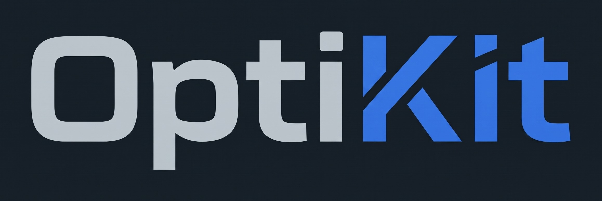

<p align="center">
  
</p>

<p align="center">
  <em>pós-formatação, debloat e otimização de sistema e jogos para Windows 10/11</em>
</p>

<p align="center">
  <a href="VERSION"></a>
  <a href="LICENSE"></a>
  <a href="win.ps1"></a>
  <a href="win.ps1"></a>
  <a href="https://github.com/seiti-kg/OptiKit/actions"></a>
</p>

<p align="center">
  <strong>60 ajustes reversíveis</strong> · <strong>46 apps via Winget</strong> · <strong>benchmark de jogos</strong> · <strong>diagnóstico read-only</strong>
</p>

Utilitário open-source de pós-formatação, debloat e otimização para Windows 10/11. Aplica ajustes reais, permite reverter pelo `state.json`/Undo e usa guardrails para não conflitar com anti-cheats de nível de kernel.

## Uso Rápido

No PowerShell, como Administrador:

```powershell
irm https://raw.githubusercontent.com/seiti-kg/OptiKit/main/win.ps1 | iex
```

Para simular sem alterar o sistema:

```powershell
powershell -ExecutionPolicy Bypass -File .\win.ps1 -DryRun
```

## Documentação

### Começando

- [Uso e automação](docs/usage.md) — one-liner, DryRun, interface, modo desatendido, códigos de saída e backups.
- [Funcionalidades](docs/features.md) — visão geral dos 60 ajustes, 46 apps, perfis, presets e limitações conhecidas.

### Referência

- [Catálogo técnico de ajustes](docs/tweaks.md) — todos os tweaks, impacto, risco, SO e justificativa.
- [Diretrizes técnicas](docs/guidelines.md) — reversibilidade, suporte a Windows, anti-cheat e arquitetura orientada a dados.
- [Ajustes rejeitados](docs/rejected.md) — tweaks placebo ou prejudiciais e critérios de admissão.

### Projeto

- [Desenvolvimento e build](docs/development.md) — estrutura, compilação, testes, CI e como adicionar ajustes/apps.

## Licença

Distribuído sob a licença [Apache 2.0](LICENSE).
